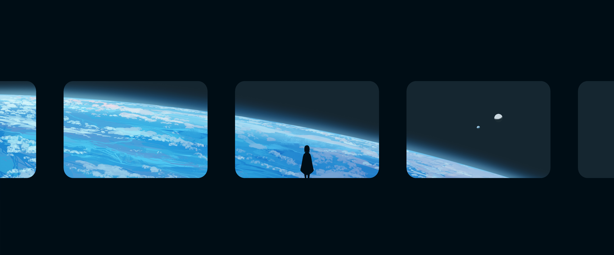
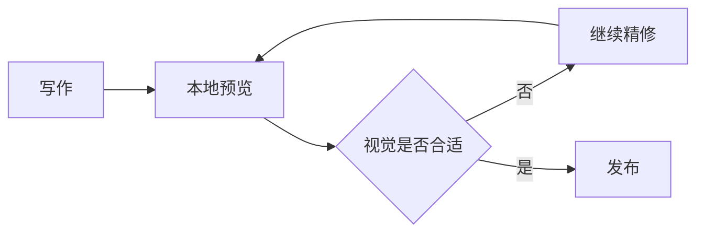
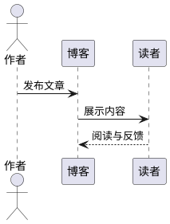

这是一篇只用于主题精修的测试稿。正文会故意把常用元素放在一起，方便检查字号、行高、间距、颜色、边框、暗色模式与移动端表现。

## 基础文字

这里有普通文本、**粗体**、*斜体*、~~删除线~~、`inline code`，以及一个指向 [Astro 官方文档](https://docs.astro.build/) 的外部链接。测试邮箱为 `hello@example.com`。

> 这是一段普通引用。它应该与正文形成清楚的层级，但不应抢走主要内容的注意力。

### 三级标题

三级标题下面安排一段稍长的文字，用来观察中文与 English words、数字 `0123456789`、标点符号以及长行换行时的阅读节奏。

#### 四级标题

四级标题适合文章内部更细的分组，也用于检查目录层级和标题锚点。

---

## 列表

无序列表：

- 第一项：简短内容
- 第二项：包含 `代码` 与 [链接](https://example.com/)
  - 嵌套项目 A
  - 嵌套项目 B
- 第三项：一段更长的说明，用来观察多行项目的缩进与行距是否自然。

有序列表：

1. 收集问题
2. 调整样式
3. 检查亮色与暗色主题

任务列表：

- [x] 创建测试稿
- [x] 覆盖主要正文组件
- [ ] 等待最终视觉定稿

## 提醒框

> [!NOTE] 普通说明
> 这是用于补充背景信息的 Note。

> [!TIP] 使用建议
> 精修时可以同时观察桌面端和移动端的留白。

> [!IMPORTANT] 重要信息
> 标题、正文和强调色应保持清晰的视觉优先级。

> [!WARNING] 注意
> 背景图较亮时，需要确认正文卡片仍有足够对比度。

> [!CAUTION] 风险提示
> 不要仅凭单一屏幕尺寸判断最终效果。

## 表格

| 元素 | 检查重点 | 当前状态 |
| :--- | :--- | :---: |
| 正文 | 字号、行高、段间距 | 待精修 |
| 代码 | 对比度、滚动、复制按钮 | 待精修 |
| 图片 | 圆角、说明、灯箱 | 待精修 |
| 图表 | 明暗主题与缩放 | 待精修 |

## 代码

短代码块：

```powershell
pnpm dev
```

长代码块用于触发代码折叠、行号、语言标识与复制按钮：

```typescript
type ThemeMode = "light" | "dark" | "system";

interface ThemeState {
	mode: ThemeMode;
	accent: string;
	reducedMotion: boolean;
}

const defaultTheme: ThemeState = {
	mode: "system",
	accent: "#39ff88",
	reducedMotion: false,
};

export function resolveTheme(state: ThemeState): ThemeState {
	if (state.reducedMotion) {
		return {
			...state,
			accent: "#2bd675",
		};
	}

	return state;
}

console.log(resolveTheme(defaultTheme));
```

## 数学公式

行内公式用于检查基线：质能方程为 $E = mc^2$。

块级公式用于检查居中、溢出与上下留白：

$$
\int_{-\infty}^{+\infty} e^{-x^2}\,dx = \sqrt{\pi}
$$

化学公式测试：$\ce{CO2 + H2O -> H2CO3}$。

## 图片

单张图片用于检查正文宽度、圆角、说明文字与灯箱：


图片网格用于检查多图排列和窄屏换行：

[grid]


[/grid]

## 扩展内容

剧透文本：按钮后面藏着 :spoiler[一段 **需要点击后显示** 的内容]。

<details>
<summary>展开查看折叠内容</summary>

这里用于检查原生折叠区块的边距、图标和展开动画。

</details>

GitHub 仓库卡片：

::github{repo="withastro/astro"}

## Mermaid 图表



## PlantUML 图表



## 脚注与结尾

这句话带有一个脚注，用于检查正文中的脚注标记与文末列表。[^layout]

[^layout]: 这是一条测试脚注，没有实际资料含义。

测试稿到此结束。正式写作时可以删掉这篇文件，或继续保留为主题回归检查页。
